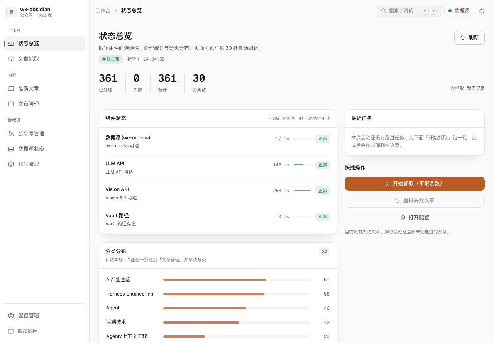
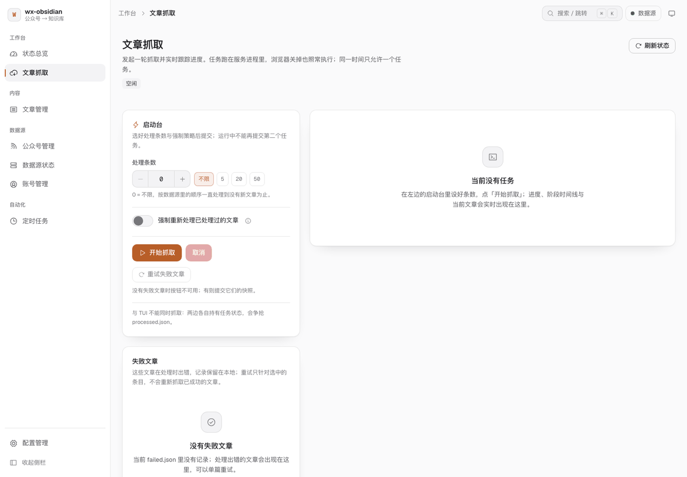
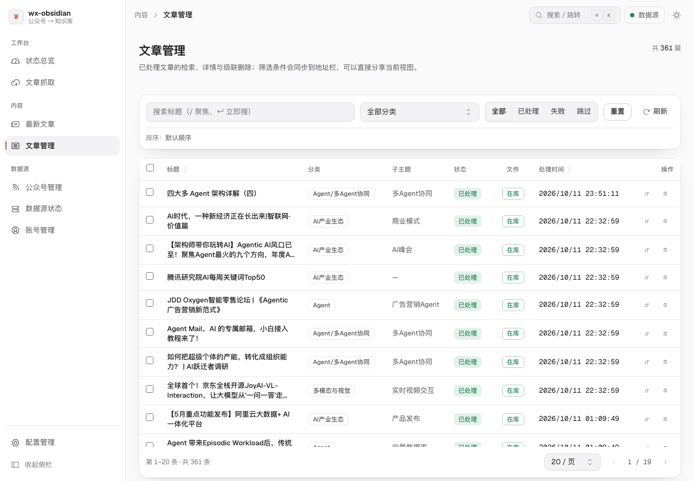

# wx-obsidian

<p align="center">
  <a href="README.md"><b>简体中文</b></a> ·
  <a href="README.en.md">English</a>
</p>

<p align="center">
  <a href="https://github.com/hxxxi-malog/wx-obsidian/actions/workflows/ci.yml"></a>
  <a href="https://github.com/hxxxi-malog/wx-obsidian/releases"></a>
  
  
  
  
  
</p>

公众号文章 → Obsidian 知识库自动化流水线：从 [we-mp-rss](https://github.com/rachelos/we-mp-rss) 抓取公众号文章，交给 DeepSeek 生成结构化笔记，写进 Obsidian Vault，并自动维护双向链接与知识图谱。
适合想把公众号技术长文沉淀进自己的 Obsidian 知识库、又不想手动复制整理的人。
提供 CLI 与 Web（浏览器界面）两种用法；一条 `docker compose up -d --build` 就能跑起来。

<p align="center">
  
</p>

## 目录

- [特性](#特性)
- [生成的笔记长什么样](#生成的笔记长什么样)
- [快速开始](#快速开始)
- [运行方式](#运行方式)
- [Docker 部署进阶](#docker-部署进阶)
- [配置](#配置)
- [工作原理](#工作原理)
- [项目结构](#项目结构)
- [定制输出](#定制输出)
- [常见问题](#常见问题)
- [开发](#开发)
- [免责声明](#免责声明)
- [致谢](#致谢)
- [许可](#许可)

## 特性

- **两种用法共用一套编排器**：命令行批量处理、FastAPI + Vue 浏览器界面
- **增量抓取**：按 `processed.json` 去重，处理过的文章不会重复花钱
- **并行 + 重试**：ThreadPoolExecutor 并行，指数退避重试（最多 3 次，覆盖 429 / 5xx / 网络错误）
- **多模态 Vision**：视觉模型为 LLM 提供图片语义描述；Vision 不可用时自动降级为纯文本 + 关键词匹配插图，不中断管线
- **改 Skill 就能改笔记风格**：章节结构、分类规则、frontmatter 由 3 个 Skill 文件控制，调风格不用改代码
- **自动成图**：`[[双向链接]]` + 概念页面 + MOC；文章间相似度用 SQLite FTS5/BM25F + jieba + 概念模糊匹配 + 标签 Jaccard，经 RRF 排名融合
- **三层格式保障**：自动校验修复 → mistune 结构性检测 → LLM 反馈修正
- **级联删除 / 可换模型渠道**：一条命令删干净一篇文章及其关联数据；`config.json` 里加一个 provider 即可换模型
- **一条命令跑起来**：数据源（we-mp-rss 派生镜像）与本项目 Web 服务由同一个 compose 项目拉起

## 生成的笔记长什么样

```markdown
---
title: "Claude Code 工程架构深度拆解"
source: "AI前线"
author: "张三"
date: 2026-06-04
tags: [Claude_Code, AI_Agent, 工程化, 上下文管理]
category: "Agent"
sub_topic: "Agent Loop"
url: "https://mp.weixin.qq.com/..."
---

## 摘要
本文深度拆解 Claude Code 的工程架构，核心论点是其竞争力源于 12 层渐进式包装……

## 核心观点
- **胖核心设计**：query.ts 刻意保持单文件，保证核心循环原子性
- **开闭原则**：所有扩展不修改核心循环，新增功能 = 新增工具 / 包装层

## 一、核心架构
Claude Code 采用了「胖核心」设计：query.ts 刻意保持单文件，保证核心循环的原子性……


## 关键概念
- [[Progressive Harness]]：渐进式工程包装，在极简内核外逐层叠加生产级特性
- [[Context Engineering]]：构建高信噪比上下文供给系统的工程方法论

## 相关主题
- [[RAG]]
```

> 来源信息（`source`、`url`）已经在 frontmatter 里，正文不再重复。

## 快速开始

前置要求：

- Docker 与 Docker Compose v2.20+（compose 文件用到 `include`，可用 `docker compose version` 查看版本）
- [DeepSeek API Key](https://platform.deepseek.com/)（也可以换成任意 OpenAI 兼容渠道，见[配置](#配置)）
- 一个 Obsidian vault 目录（在 Web 配置页里填写其路径）

不想用 Docker 就走源码方式（Python 3.12+），见下面的[运行方式](#运行方式)。

**1. 起服务**

```bash
git clone https://github.com/hxxxi-malog/wx-obsidian.git
cd wx-obsidian

# 数据源后台账号
cp deploy/we-mp-rss/.env.example deploy/we-mp-rss/.env     # 填 WERSS_USER / WERSS_PASS

# Web 访问令牌（留空则每次重启随机生成，收藏的 URL 会失效）
cp deploy/wx-obsidian/.env.example deploy/wx-obsidian/.env
openssl rand -base64 24                                    # 把这串填进 WX_WEB_TOKEN=

docker compose up -d --build
docker compose ps                                          # 两个都应显示 Up 且 (healthy)
```

默认挂载 `~/Documents/公众号文章` —— 这是 `obsidian.vault_path` 与 `articles_dir` 拼出来的**文章目录**，容器内外用**同一个绝对路径**（`processed.json` 存的就是绝对路径）；你的文章目录在别处就 `export WX_VAULT_DIR=/path/to/公众号文章` 再起。

**2. 初始化数据源**

打开 <http://localhost:8001>，完成初始化 → 扫码登录微信读书 → 添加要订阅的公众号。只想单独跑数据源：`cd deploy/we-mp-rss && docker compose up -d --build`。
采集通道固定为 `weread_mp`（微信读书 Web），绕开公众平台后台接口的 `ret=200013` 风控；原 WeWe RSS 已归档、其闭源中转下线，所以改用 we-mp-rss —— 为什么用派生镜像、怎么升级补丁见 [`deploy/we-mp-rss/README.md`](deploy/we-mp-rss/README.md)。

**3. 配置并抓取**

打开 `http://127.0.0.1:8765/?token=<上一步的 WX_WEB_TOKEN>` —— **token 是必须的**，直接访问只能看到页面、调不通接口（这个服务能写你的硬盘、读你的 API Key）。

1. 「配置管理」填 **DeepSeek API Key** 和 **Vault 路径**，点「测试连通性」
2. 「文章抓取」发起抓取，可以先只跑 5 篇
3. 「文章管理」看结果；在 Obsidian 里打开 Vault，Graph View 就是知识图谱

## 运行方式

| 方式 | 入口 | 说明 |
|------|------|------|
| Docker（推荐） | `docker compose up -d --build` | 数据源 + Web 界面，见上 |
| CLI | `python process_articles.py` | 批量跑一轮，不常驻 |
| Web | `python process_articles.py web` | 浏览器界面，与容器里那个是同一个 |

源码方式先装依赖：`uv sync`（推荐）或 `pip install -e .`。

**CLI**

```bash
python process_articles.py                   # 处理所有未处理的文章
python process_articles.py --limit 5         # 只处理 5 篇
python process_articles.py --force           # 忽略 processed.json 去重账本，强制重跑
python process_articles.py --article-id <id> # 只处理指定 ID
python process_articles.py delete "标题或ID"  # 级联删除一篇文章的全部关联数据
./run.sh --limit 5                           # 同上，额外把输出追加到 logs/run.log
```

**Web**

```bash
python process_articles.py web                  # 自动打开浏览器
python process_articles.py web --port 8765 --no-open
# 默认只绑 127.0.0.1；要对外监听得用模块入口（web 子命令只透传 --port / --no-open）
python -m wx_obsidian.web --host 0.0.0.0 --allow-remote
# 等价的 env 写法：WX_WEB_HOST=0.0.0.0 python process_articles.py web
```

七个页面：状态总览 / 文章抓取 / 文章管理 / 配置管理 / 公众号管理 / 数据源状态 / 账号管理。
文章管理页有搜索 / 筛选 / 排序 / 分页 / 详情抽屉 / 多选批量删除 / 级联删除 / 在 Obsidian 打开；配置页有原生目录选择器和「未保存改动」守卫；列表页按 `/` 聚焦搜索框。
通用能力：常驻**任务坞**（切页面不断流）、**命令面板**（`⌘K`）、深浅双主题、筛选与分页状态写进 URL（刷新、后退、发链接都不丢）、空态 / 骨架 / 错误三态齐全、`prefers-reduced-motion` 下动效自动关闭。
几件必须知道的事：

- **只绑 `127.0.0.1`，除 `/api/ping` 外的所有 `/api/*` 都要启动时打印的 token**（`X-WX-Token` 头或 `?token=`），局域网内其它机器访问不到；进度走 SSE，断线或刷新会自动重连并按事件序号补齐
- **密钥只回显掩码**：配置页留空表示「不修改」，不会清掉已存的 Key；日志同样过掩码过滤器（`sk-` / `token=` / `Bearer`）
- **任务单飞**：同一时刻只允许一个抓取任务，第二个请求返回 409 —— `processed.json`、MOC、概念页都不能并发写
- **⚠️ 不要同时用 CLI 和 Web 发起抓取**：两边各自持有任务状态，会争抢 `processed.json`，要跑就开一个
- **退出**：网页上的「退出应用」（`POST /api/shutdown`）会让服务干净收尾，容器里它就是「停服务」的入口；终端里 Ctrl+C / SIGTERM，或 `pkill -f wx-obsidian` 同样有效

<p align="center">
  
  <br><sub>文章抓取：处理条数与强制重跑、实时进度、阶段时间线、失败清单</sub>
</p>

<p align="center">
  
  <br><sub>文章管理：搜索 / 筛选 / 详情抽屉 / 多选批量删除 / 在 Obsidian 打开</sub>
</p>

## Docker 部署进阶

| 事项 | 做法 | 为什么 |
|---|---|---|
| 只给本机 | `ports` 默认 `127.0.0.1:8765` | 这套服务能写你的 vault、读你的 API Key |
| 手机 / 其它设备访问 | `WX_WEB_BIND=0.0.0.0 docker compose up -d` | 明文 HTTP 里的 token 会走在网线上，优先 Tailscale 或 SSH 隧道 |
| 换端口 | `WX_WEB_PORT=8766 docker compose up -d` | 与其它实例并存 |
| 令牌稳定 | `WX_WEB_TOKEN`（`deploy/wx-obsidian/.env`） | 容器会重启，随机令牌会让收藏的 URL 失效 |
| 数据在哪 | `~/.wx-obsidian` 与 vault 都是**绑定挂载** | `processed.json` 只能有一份，否则容器与宿主会把同一篇各处理一遍 |
| vault 挂载点 | 与宿主机**同一个绝对路径** | 记录里存的是绝对路径，挂到 `/vault` 会让级联删除静默失效 |
| 数据源地址 | 容器内 `http://we-mp-rss:8001`（compose 注入 `WX_SOURCE_BASE_URL`） | `config.json` 与宿主共用，只有地址这类随环境变化的值按环境区分 |
| 看日志 | `docker compose logs -f wx-obsidian` | 容器里没有 `~/Library/Logs`；同时落盘到 `~/.wx-obsidian/logs/app.log` |
| 重启策略 | `on-failure` | 这样网页上的「退出应用」才真的是「停」，不会被 Docker 立刻拉起 |

容器里的 `WX_ALLOW_REMOTE=1` 看着像放宽了安全，其实不是：经发布端口进来的连接，容器看到的客户端 IP 是**容器网关**（实测 `192.168.117.1`），不放行连宿主自己的浏览器都会 403。
**真正的边界是上表第一行的宿主端口绑定；token 校验在任何情况下都强制。**

> 从旧方式（直接 `cd deploy/we-mp-rss && docker compose up -d`）迁过来，先 `cd deploy/we-mp-rss && docker compose down`，否则容器名冲突。数据在挂载卷里，不受影响。

## 配置

| 内容 | 位置 | 谁在用 |
|------|------|--------|
| API Key、运行时开关 | `~/.wx-obsidian/.env`（模板 [`.env.example`](.env.example)） | CLI / Web；Web 配置页会代写 |
| Vault 路径、分类、数据源、模型渠道、端口 | `~/.wx-obsidian/config.json` | 所有入口共用 |
| 去重账本 / 相似度索引 / 日志 | `~/.wx-obsidian/` 下的 `processed.json` / `similarity.sqlite` / `logs/` | 程序自动维护 |

常用环境变量（密钥类模板见 [`.env.example`](.env.example)，容器开关见 [`deploy/wx-obsidian/.env.example`](deploy/wx-obsidian/.env.example)；`WX_SOURCE_BASE_URL` 由 compose 注入、不在任何模板里）：

| 变量 | 必填 | 说明 |
|------|------|------|
| `DEEPSEEK_API_KEY` | 是 | LLM 与 Vision 默认共用这一个 Key |
| `DEEPSEEK_BASE_URL` / `MODEL_NAME` | 否 | 默认 `https://api.deepseek.com` / `deepseek-flash` |
| `VISION_API_KEY` / `VISION_BASE_URL` / `VISION_MODEL_NAME` | 否 | 独立视觉渠道，留空即与 LLM 共用 |
| `MAX_VISION_CONCURRENCY` / `VISION_TIMEOUT` / `VISION_MAX_RETRIES` | 否 | 默认 `10` / `120` 秒 / `2` |
| `WX_SOURCE` / `WX_SOURCE_BASE_URL` | 否 | 数据源类型（当前仅 `we_mp_rss`）与地址覆盖 |
| `WX_WEB_TOKEN` / `WX_WEB_HOST` / `WX_ALLOW_REMOTE` | 否 | Web 启动期开关，容器部署用 |
| `DEBUG` | 否 | 布尔开关：`1/true/yes/on` 开启，`0/false/no/off`（默认）关闭，认不出的取值按关闭并记一条告警；开启时把 API 原始响应写到 `last_response.txt` |

`~/.wx-obsidian/config.json` 的关键字段（Web 的配置页可直接编辑）：

```jsonc
{
  "source":   { "type": "we_mp_rss", "base_url": "http://localhost:8001", "timeout": 15, "token": "" },
  "fetch":    { "max_days": 7, "max_workers": 5, "feed_limit": 300 },
  "llm":      { "active": "deepseek", "providers": { "deepseek": { "base_url": "https://api.deepseek.com", "model": "deepseek-flash", "api_key_env": "DEEPSEEK_API_KEY" } }, "max_tokens": 4096, "temperature": 0.7 },
  "vision":   { "enabled": true, "active": "deepseek", "max_concurrency": 10, "timeout": 120, "max_tokens": 3072, "inline_images": true },
  "obsidian": { "vault_path": "/path/to/vault", "articles_dir": "公众号文章" },
  "web":      { "port": 8765, "host": "127.0.0.1", "allow_remote": false, "open_browser": true, "log_level": "INFO" }
}
```

- `web.host` / `web.allow_remote` 是**启动期**设置，改了要重启（容器里用 `WX_WEB_HOST` / `WX_ALLOW_REMOTE` 覆盖）
- `llm.active` / `vision.active` 指向 `providers` 里任意 OpenAI 兼容渠道：加一个 provider 就能换模型，不用改代码
- `categories` 由程序维护：分类清单本身在 `skills/classification/SKILL.md`，运行中发现新分类会建目录 / MOC 并追加进这个列表

## 工作原理

```
process_articles.py / docker compose
    └── wx_obsidian/orchestrator.py           # 6-stage 编排器，CLI / Web 共用
            ├── sources/     数据获取（we-mp-rss 客户端 + 正文提取）
            ├── processing/  处理层（Vision / LLM / Markdown / 图片 / 相似度）
            ├── output/      输出层（Vault 写入 / 格式校验 / 级联删除）
            └── batch.py     并行执行 + 指数退避重试
```

| Stage | 模块 | 做什么 |
|-------|------|--------|
| 1 Fetch | `orchestrator.py` | 拉取文章 + 正文提取 |
| 2 Vision | `processing/vision.py` | 图片语义描述（可选，失败自动降级为纯文本） |
| 3 LLM | `processing/llm.py` | 生成结构化 JSON（分类 / 摘要 / 概念 / 正文） |
| 4 Markdown | `processing/markdown.py` + `output/validator.py` | 生成并校验 Obsidian Markdown |
| 5 Image | `processing/images.py` | 替换 `[IMG:N]` 占位符 / 按关键词匹配插入图片 |
| 6 Write | `orchestrator.py` | 写入 Vault + 更新 `processed.json` |

之后还有两步收尾：算文章间相似度（`processing/similarity.py`），更新 MOC / 概念页面 / 子目录拆分。
Vault 结构：`_MOC.md`（总目录）→ 各分类目录（`LLM基础/`、`Agent/` …）→ `<sub_topic>/` 子目录（同一子主题满 3 篇后自动建目录并迁移），另有 `Z归档/26/06/07.md` 按日期归档、`概念/` 自动聚合引用它的文章。
关联关系有三层：文章 → 概念（LLM 提取的 `[[概念名]]`）、概念 → 文章（backlink 自动聚合）、文章 → 文章（混合关联算法，每篇最多 3 篇，阈值 0.05）。

## 项目结构

```
wx-obsidian/
├── process_articles.py      # CLI 入口（cli / web / delete / migrate-vault）
├── run.sh                   # 手动跑一轮的快捷脚本（输出同时落 logs/run.log）
├── wx_obsidian/
│   ├── orchestrator.py      # 核心编排器（6-stage pipeline，CLI / Web 共用）
│   ├── sources/             # 数据获取层（we-mp-rss 客户端 + 正文提取）
│   ├── processing/          # 处理层（Vision / LLM / Markdown / 图片 / 相似度）
│   ├── output/              # 输出层（Vault 写入 / 格式校验 / 级联删除）
│   └── web/                 # FastAPI + Vue 浏览器界面
├── skills/                  # 3 个 Skill，控制笔记风格
├── prompts/                 # LLM prompt 模板（system / user 分开）
├── deploy/                  # Docker 部署配方（含 we-mp-rss 派生镜像）
├── tests/                   # 单元测试 + 端到端冒烟
├── docs/                    # 设计规格与决策记录
└── assets/                  # README 截图
```

更细的架构、依赖流向、编码红线（路径安全 / 原子写入 / 异常规范 / 依赖隔离）和「改哪个文件会影响什么」见 [`AGENTS.md`](AGENTS.md)（[`CLAUDE.md`](CLAUDE.md) 是同一份内容的镜像）。

| 文档 | 内容 |
|------|------|
| [`AGENTS.md`](AGENTS.md) | 架构、依赖流向、编码红线、改动影响地图、开发任务索引 |
| [`.github/CI.md`](.github/CI.md) | CI / 安全扫描 / CD 三条流水线与密钥防线说明 |
| [`deploy/we-mp-rss/README.md`](deploy/we-mp-rss/README.md) | 数据源派生镜像的由来、发布期补丁与升级方式 |
| [`docs/design-docs/`](docs/design-docs/) | 各功能的设计规格与实现决策 |

## 定制输出

3 个 Skill 文件控制 AI 输出，改 Markdown 就能改风格，不用动 Python：

| Skill | 路径 | 控制 |
|-------|------|------|
| `article-body` | `skills/article-body/SKILL.md` | 章节结构（4-6 节）、写作风格、表格与图片规范 |
| `classification` | `skills/classification/SKILL.md` | category 选择、sub_topic 提取规则 |
| `note-metadata` | `skills/note-metadata/SKILL.md` | frontmatter 格式、摘要、概念提取、相关主题 |

Prompt 拆成 system / user 两份（`string.Template` 的 `$变量` 占位符），改文件即可换 prompt：`prompts/summarize_system.txt`（静态，可被 KV cache 复用）、`summarize_user.txt`（注入正文 + Skill + 图片上下文）、`refine_system.txt` / `refine_user.txt`（图片修订）。

分类清单的唯一事实来源是 `skills/classification/SKILL.md`（Python 侧不硬编码分类表）；预设 6 组，运行时遇到新分类会自动建目录 / MOC 并追加进 `config.json` 的 `categories`。
预设分组 —— 模型层：LLM基础、训练与微调、多模态与视觉、具身智能；Agent 层：`Agent`（多 Agent 协同、RAG、MCP、上下文工程、Prompt 工程都归在这里）；应用层：AI编程、后端技术；工程层：Harness Engineering；生态层：AI产业生态；兜底：其他。
冲突时「专题优先于基础领域」：讲微调 → 训练与微调，讲推理优化 → LLM基础。

> Skill / Prompt 的改动只影响之后处理的文章；想按新风格重跑已有文章用 `python process_articles.py --force`（会重新消耗 API 额度）。

## 常见问题

**账号管理 / 公众号管理页显示「查不到」。**
`/feed/*.json` 是公开只读接口，**抓取不需要任何凭据**；但这两个页面读的是 we-mp-rss 的 `/api/v1/wx/*` 管理接口，需要 Bearer 令牌。
没配时上游返回 401，界面只会显示「查不到 / 未登录」。令牌是 JWT，配置页会显示到期时间；取令牌的命令见 [`deploy/we-mp-rss/README.md`](deploy/we-mp-rss/README.md)。

**日志在哪？**
Docker 用 `docker compose logs -f wx-obsidian`（同时落盘 `~/.wx-obsidian/logs/app.log`）；源码方式在 macOS 上落 `~/Library/Logs/wx-obsidian/app.log`，其它平台落 `~/.wx-obsidian/logs/app.log`（2MB × 3 轮转）。
日志里有 `print()` 出来的管线进度（容器接管 stdout，源码方式 `print()` 仍在终端），`sk-` / `token=` / `Bearer` 都会被掩码。
端到端自检（临时 HOME + 本地 stub 上游真跑一轮，**不花 API 费用、不碰真实 vault**）：

```bash
.venv/bin/python tests/e2e/smoke_web.py            # 抓一篇 → 断言笔记 / 账本 / 日志 / 干净退出
.venv/bin/python tests/e2e/smoke_web.py --keep     # 保留临时目录便于排查
```

**搬过 Vault 之后。**
`processed.json` 里记的 `file` 是绝对路径，搬完必须迁移一次，否则**级联删除会静默失效**（去重不受影响，按文章 ID）：

```bash
python process_articles.py migrate-vault /Users/you/Documents --dry-run   # 先预览
python process_articles.py migrate-vault /Users/you/Documents             # 再执行
```

Obsidian 是**按绝对路径**注册仓库的，搬完还要用「打开文件夹作为仓库」重选一次，否则点「打开」会报 Vault not found。

**能换模型吗？**
可以。`config.json` 的 `llm.providers` / `vision.providers` 里加一个 OpenAI 兼容渠道（`base_url` + `model` + `api_key_env`），再把 `llm.active` / `vision.active` 指过去即可；配置页同样能改。LLM 与 Vision 可以是不同渠道。

**有没有定时抓取？**
没有，应用内调度功能已整体移除。手动跑 `./run.sh [--limit N]`、`python process_articles.py`，或在 Web 的「文章抓取」页点一次开始。

**想删一篇已经生成的文章？** 见上面 CLI 小节里的 `delete` 子命令：它会清理文章 `.md`、分类 `_MOC.md` 里的条目、概念页面里的相关链接（无剩余链接时删除概念页面）、日归档条目和 `processed.json` 记录。

## 开发

技术栈：Python 3.12 · FastAPI · requests / mistune / jieba · SQLite FTS5；前端 Vue 3 + TypeScript + Tailwind v4 + Reka UI + Phosphor；部署 Docker Compose。

```bash
ruff check .                                                # lint
ruff format .                                               # format
mypy wx_obsidian/ process_articles.py validate_markdown.py   # 类型检查
pytest                                                      # 单元测试
python validate_markdown.py --dir <directory>                # 校验 Markdown
```

`tests/conftest.py` 会把 `~/.wx-obsidian/` 下的真实状态文件重定向到临时目录，跑测试不会动你的 `processed.json`。

前端（`wx_obsidian/web/frontend`，自建设计系统：Tailwind v4 + Reka UI + Phosphor）：`pnpm install` 后 `pnpm verify`（= `type-check && style-guard && test && build`，四道门缺一不可），开发用 `pnpm dev`（5173，`/api` 代理到 8765）。

欢迎 issue / PR。提交前请让上面的检查全部通过；改 README 时请同步更新 [README.en.md](README.en.md)（英文版与中文版结构一一对应）。变更记录见 [GitHub Releases](https://github.com/hxxxi-malog/wx-obsidian/releases)。

CI / 安全扫描 / CD 三条流水线与 `.env` 密钥防线的三道关见 [`.github/CI.md`](.github/CI.md)。

## 免责声明

文章正文、图片与生成中的笔记内容会发送到你所配置的 LLM API（默认 DeepSeek）用于生成与修订。
数据源、Vault、`processed.json` 与相似度索引都只存在你自己的机器上，本项目不上传任何内容到其它第三方。
请自行确认所抓取内容的版权与使用范围。

## 致谢

数据源与公众号正文提取依赖 [we-mp-rss](https://github.com/rachelos/we-mp-rss)（部署配方在 `deploy/we-mp-rss/`）；Web 界面用 FastAPI + Vue 3 + Tailwind。

## 许可

[MIT](LICENSE) © malog
